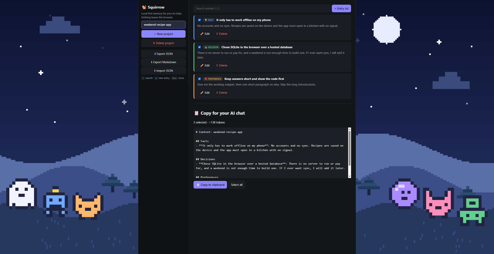

# Hi, I'm Thymeed

**Software Developer · AI tools, agent workflows and evals · local-first apps**

I build with a multi-agent Claude Code workflow. A Sonnet session plans each change and splits it into small units. Haiku workers make the edits, and a stronger model (Sonnet or Opus) reviews every PR. Anything the review finds goes back to a worker before the PR opens. Nothing merges until CI is green and I've tested it by hand.

**Squirrow v1.1.0:** shipped as 7 PRs in about 2.5 hours, using 43.8M tokens (97.3% cache reads), at an estimated $6.81 at list price, with 22 review findings fixed before merge. **[Full log →](https://github.com/thymeed/thymeed/blob/main/docs/Orchestration_log.md)**

**FocusPet:** in one day of work, 38 subagent runs covered 12 issues in three batches. Haiku and Sonnet workers wrote the code, and Opus reviewers and advisors checked every PR before it shipped. That came to 4.07M subagent tokens and at least $9.67 at list price, with 10 "fix first" reviews resolved before shipping.

---

## Open-source contributions
- [cubrid-mcp-server #369](https://github.com/cubrid-lab/cubrid-mcp-server/pull/369): added a full truth-table test for `parse_bool` (merged)
- [cubrid-mcp-server #374](https://github.com/cubrid-lab/cubrid-mcp-server/pull/374): pinned the rule that named connections don't inherit default settings, with a mutation check (merged)

---

## Projects

### FocusPet · Tauri 2 + Rust · Windows
A desktop companion with local LLM chat through Ollama, so conversations never leave your machine. Network access is off by default.

**Evals:** a seeded harness (gemma3:4b, 15 prompts × 3 seeds) that scores tool-call replies with a unit-aware checker and records the model digest and git SHA with every run. Adding tool calls took the score from 24/45 to 42/45. Every behavior change is gated on before-and-after tables, and known failures are logged rather than tuned away.

*Private repo. Demo on request.*

### [agent-workshop](https://github.com/thymeed/agent-workshop) · Electron + Node
A desktop dashboard that shows how a multi-agent coding session routes work across Opus, Sonnet and Haiku. It has zero runtime dependencies. CI builds Windows, macOS and Linux installers for every release, with SHA-256 checksums.
**[Download the latest release →](https://github.com/thymeed/agent-workshop/releases/latest)**

  

### [Squirrow](https://github.com/thymeed/Squirrow) · React 19 + TypeScript
A local-first memory manager for your AI chats. It needs no account, and your data stays in your browser. It installs as an offline app.
**[Try it live](https://squirrow.thymeed.workers.dev)** · **[How it was built →](https://github.com/thymeed/Squirrow/blob/main/docs/orchestration-log.md)**

  

---

## Research

- **[ssm-state-quantization](https://github.com/thymeed/ssm-state-quantization)**: how rounding the recurrent state of Mamba-2 (130M and 370M) hurts accuracy, broken down by how fast each head forgets. Every experiment is pre-registered in the log before it runs. *Private repo. Demo on request.*
   
- **[replication-criterion](https://github.com/thymeed/replication-criterion)**: a pre-registered feasibility analysis of machine self-replication.
   

---

## Stack

Rust · TypeScript · JavaScript/Node · Python
Tauri 2 · Electron · Win32 · React · Vite · GitHub Actions

AI tools: Claude Code · Cursor · Ollama · MCP · pytest
