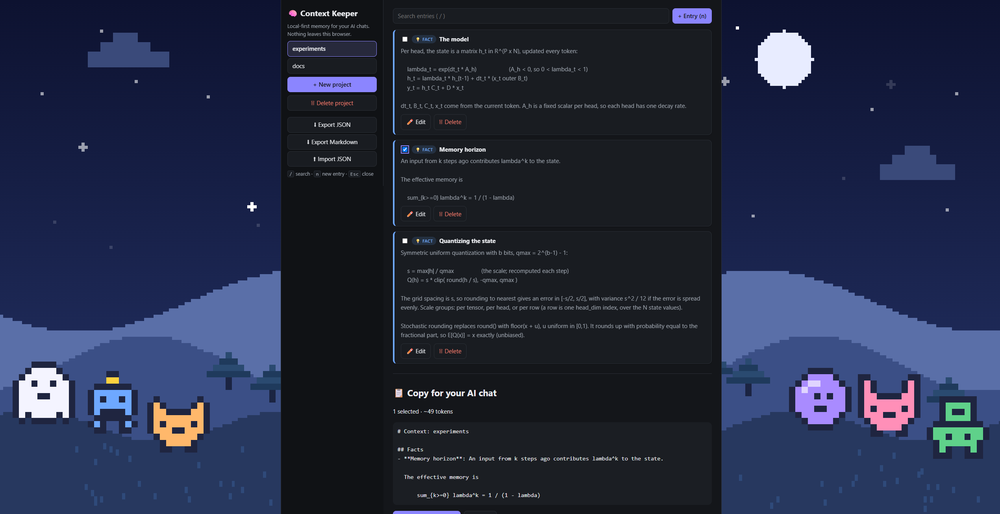

# Hi, I'm Thymeed

**Software Developer · AI tools, agent workflows and evals · local-first apps**

I design, review and ship desktop and web apps built with AI coding agents. Each agent has a fixed role: Sonnet directs and plans, Haiku implements, researches and explores, and Opus reviews and advises. When Opus finds a problem, the work goes back to Haiku and gets reviewed again. Nothing merges without green CI on every platform and my final review.

---

## Open-source contributions
- [cubrid-mcp-server #369](https://github.com/cubrid-lab/cubrid-mcp-server/pull/369): added a full truth-table test for `parse_bool` (merged)
- [cubrid-mcp-server #374](https://github.com/cubrid-lab/cubrid-mcp-server/pull/374): pinned the rule that named connections don't inherit default settings, with a mutation check (merged)

---

## Projects

### FocusPet · Tauri 2 + Rust · Windows
A desktop companion with local LLM chat through Ollama, so conversations never leave your machine. Network access is off by default.
*Private repo. Demo on request.*

### [agent-workshop](https://github.com/thymeed/agent-workshop) · Electron + Node
A desktop dashboard that shows how a multi-agent coding session routes work across Opus, Sonnet and Haiku. It has zero runtime dependencies. CI builds Windows, macOS and Linux installers for every release, with SHA-256 checksums.
**[Download the latest release →](https://github.com/thymeed/agent-workshop/releases/latest)**

  

### [context-keeper](https://github.com/thymeed/context-keeper) · React 19 + TypeScript
A local-first memory manager for your AI chats. It needs no account, and your data stays in your browser. It installs as an offline app.
**[Try it live →](https://context-keeper.thymeed.workers.dev)**

  

---

## Research

- **[ssm-state-quantization](https://github.com/thymeed/ssm-state-quantization)**: why 8-bit rounding of Mamba-2's recurrent state nearly doubles perplexity, by decay rate.

   
- **[replication-criterion](https://github.com/thymeed/replication-criterion)**: a pre-registered feasibility analysis of machine self-replication.
   

---

## Stack

Rust · TypeScript · JavaScript/Node · Python
Tauri 2 · Electron · Win32 · React · Vite · GitHub Actions

AI tools: Claude Code · Cursor · Ollama · MCP · pytest
